CAO's dashboard is a **rebuildable analytical read model**, not the system of
record for GitHub activity or the authority for workflow execution. Think of it
as a CQRS-style read side: source adapters normalize evidence into a canonical
model, and declarative queries serve bounded projections to the UI. This is a
mental model, not a claim that CAO implements a general-purpose CQRS framework
or event-sourcing platform.

This guide translates the working-draft
[Dashboard Data Architecture Specification](https://github.com/githubnext/gh-cao/blob/main/specs/dashboard-data.md)
for cloud architects. It explains the documented contracts, not an attestation
that every deployment satisfies them. The checked-out specification and
`ARCHITECTURE.md` govern changes; this guide does not supersede them.

## 1. Architecture at a glance

Three boundaries matter: **authority**, **evidence acquisition**, and
**analytical serving**. They may share a deployment, but not ownership or
authorization semantics. Analytical evidence has two distinct products: the
minimized canonical dashboard read model and the independently approved,
default-off **agent unified-session data lake**.

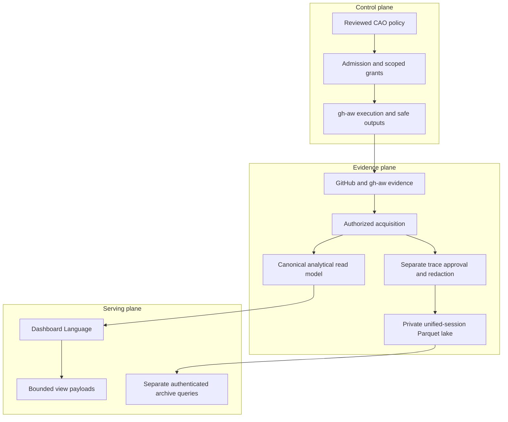

| Architectural concern | CAO contract | Design implication |
| --- | --- | --- |
| System of record | GitHub, gh-aw evidence, and reviewed policy remain external authorities. | Clearing a dashboard projection cannot revoke policy or erase GitHub history. |
| Anti-corruption layer | Source adapters translate provider-specific formats into canonical observations. | Neither SQL tables nor log schemas become the UI's domain model. |
| Read-side portability | IndexedDB, local SQLite, and hosted PostgreSQL expose canonical query contracts. | Shared semantics do not imply identical durability, capacity, or query support. |
| Private session lake | Approved unified-session events live in immutable Parquet, locally or in private Azure Blob Storage. | DuckDB or generation-bound ADX queries use separate content grants; no automatic dashboard join or fallback. |
| Control-plane isolation | Dashboard facts and computation results grant no execution authority. | Enrollment, dispatch, and mutation require their separate policy and authorization paths. |

**Source:** `ARCHITECTURE.md`, dashboard-data specification Abstract and §§3-5;
[Private unified-session archive](https://github.com/githubnext/gh-cao/blob/main/specs/session-archive.md#status-and-scope).

## 2. Deployment topology and backend selection

Select the serving topology explicitly. A hosted outage is not permission to
switch the client to a different data plane.

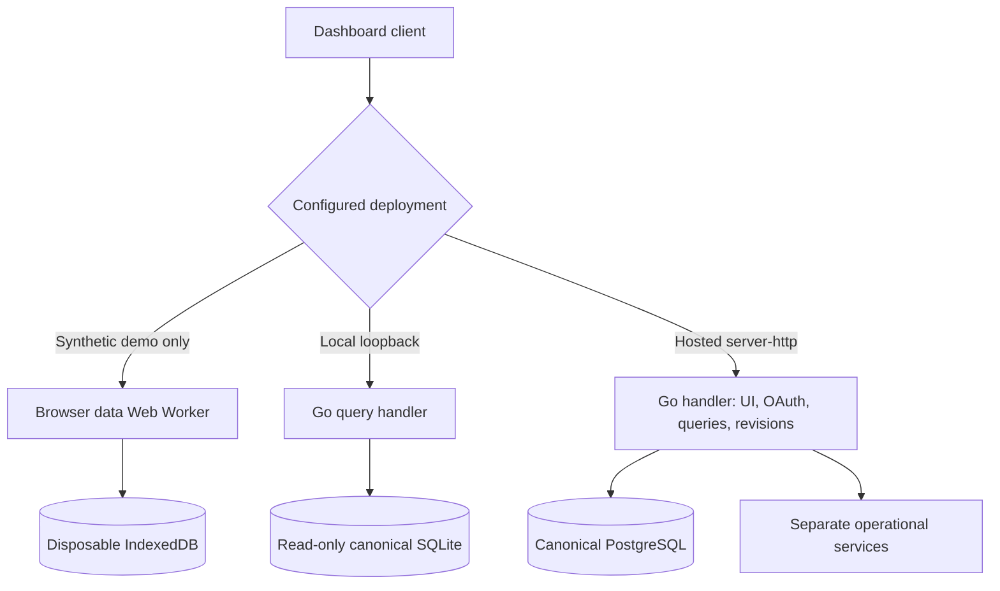

| Topology | Query execution | Persistence and ownership | Appropriate use |
| --- | --- | --- | --- |
| Synthetic Pages demo | Data Web Worker over IndexedDB | Generated samples, production canonical ingestion; isolated disposable browser state | Enterprise sample exploration, never operational evidence distribution |
| Local/headless | Go over a selected read-only canonical SQLite snapshot | The Activity pipeline owns ordinary snapshot creation, retention, and repair | Operator analysis, CLI consumption, and local development |
| Production hosted | Go over PostgreSQL using bounded, parameterized SQL | Server-side canonical namespace plus separately owned operational state | Authenticated shared dashboards and optionally native acquisition |

Containers, Azure Functions, and external-listener hosts use the **complete
Go handler on one origin**: HTML, assets, OAuth, query APIs, and revision
events. The server injects `server-http`; clients never receive database
credentials. Hosted startup rejects missing dashboard assets, and hosted
service failures do not fall back to Pages, shard ingestion, or IndexedDB.

Ordinary local SQLite serving is query-only: the Go server does not collect
GitHub evidence, start an ingestion runtime, or create a writable overlay.
The separately selected immediate operator CLI can acquire a private bounded
projection outside that server; it is not a hosted failover mechanism.

Pages generates raw synthetic samples, normalizes them through the production
pipeline, and uses the same canonical queries and views. Its declarative
**Synthetic enterprise demo** callout is not a live-service health indicator.
Daily documentation/demo builds do not depend on operational artifact freshness
and publish neither SQLite nor an agent summary.

The demo's `demo-data-v1/` data URLs, `synthetic-demo-v1` browser storage-key
suffix, and `demo-v1` service-worker caches isolate it from old same-origin
operational data, including cached responses at former URLs. This removes
live-data publication and implicit acquisition paths, not the cost of the
IndexedDB/worker/service-worker adapters and cross-backend conformance.
Operational artifacts remain bounded read-only transport for authorized local
and hosted consumers. Acquisition requires authenticated Actions access or an
explicit direct operational `payload-hashes.json` URL; there is no default
Pages download or implied hosted export API.

Migration does not scrub old deployments or browser storage. Redeploying the
demo replaces current Pages artifacts; legacy real-data browser databases stay
unused and disposable until explicitly cleared. The demo never automatically
deletes storage outside its namespace.

**Source:** dashboard-data §5.2 Go server profile; [Deployment](deployment.md).

## 3. Acquisition: batch publication or native collection

Acquisition profile and HTTP hosting are independent design axes. Choose
**exactly one acquisition writer** for a deployment.

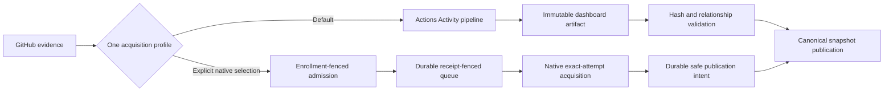

The default **Actions profile** publishes inventory, hashes, compact normalized
run-information JSONL, run-record JSONL, and a SQLite projection for headless
consumers. Raw Activity JSONL remains in the Activity cache, not the deployed
browser payload. Browser ingestion reads JSONL and inventory; it does not
import the SQLite database into IndexedDB.

The optional **native collector profile** requires explicit native selection,
canonical PostgreSQL, and durable PostgreSQL operational ownership. GitHub
App configuration alone is insufficient. It uses installation-scoped APIs,
bounded exact-attempt acquisition, and shared quota services rather than
shelling out to Activity or gh-aw. Both profiles must produce equivalent
canonical records for equivalent underlying evidence and observation windows.

This is an **at-least-once delivery and fenced-publication design**, not an
exactly-once transport guarantee:

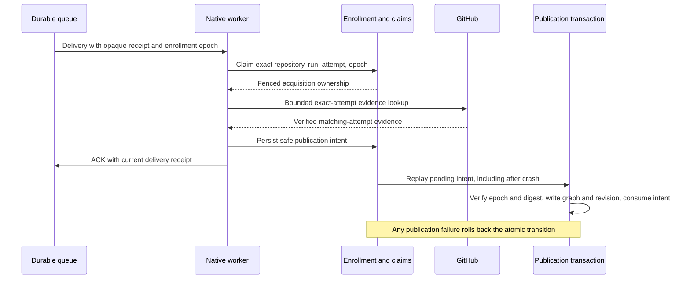

Enrollment withdrawal or transfer invalidates obsolete claims and pending
publication. Missing authority, ambiguous attempts, capacity exhaustion, and
incomplete acquisition remain errors or explicit coverage gaps, never inferred
successful collection.

**Source:** [Server Ingestion Specification](https://github.com/githubnext/gh-cao/blob/main/specs/server-ingestion.md),
§§2, 2.4 and 3-9.

## 4. Data lineage and canonical domain boundaries

The source adapter is the **anti-corruption layer**. Normalization establishes
identity, provenance, attempt ownership, nullability, and referential integrity
before downstream consumers see records.

```mermaid
flowchart LR
  accTitle: Canonical data lineage
  accDescr: Provider evidence becomes source-neutral observations, deterministic canonical entities, validated storage, declarative queries, and bounded view payloads.
  Input["Provider evidence or static SQL export"] --> Adapter["Source adapter"]
  Adapter --> Normalize["Deterministic normalization"]
  Normalize --> Integrity["Identity and relationship validation"]
  Integrity --> Store[("Canonical storage")]
  Store --> Query["Declarative query plan"]
  Query --> Payload["View payload and quality metadata"]
```

The static SQL export is a **versioned interchange contract**, not the local
SQLite schema and not a browser database connection. An upstream owner exports
SQL tables or views to JSON before adaptation.

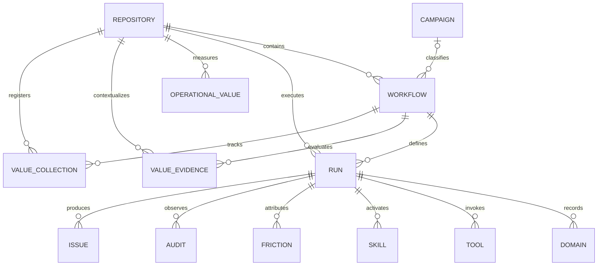

This is a **bounded-context map**, not the complete physical schema.
Marketplace and experiment, assignment, grader, and eval evidence extend the
model; their definitions and observations must preserve their own identity and
grain. Issue includes both issues and pull requests, distinguished by
`isPullRequest`. Canonical Audit records are curated execution observations,
not the separate durable operational audit ledger.

Immutable GitHub IDs are preferred for Repository and Workflow. Current
publication can require transitional deterministic source-coordinate IDs;
do not assume every producer already supplies immutable IDs. Run identity is
repository-scoped GitHub run identity, not a new entity for every retry.
Newer attempts replace applicable evidence; older attempts must not contaminate
the winning attempt. Names, display labels, ingestion order, and wall clocks
are not identity substitutes.

**Source:** dashboard-data §§5.1, 6-12 and 14-19;
[Data model](dashboard-data-model.md).

## 5. Analytical storage versus operational durability

Two PostgreSQL-backed concerns can share infrastructure without sharing
contracts, tables, schema lifecycle, or rebuild behavior. The private session
lake is a third ownership boundary, not another PostgreSQL schema.

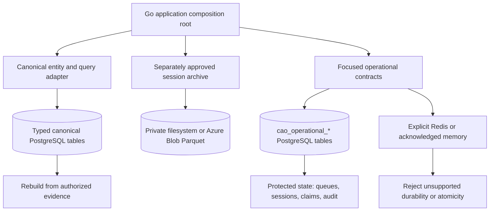

| Storage concern | Recovery semantics | Important limitation |
| --- | --- | --- |
| Canonical PostgreSQL | Rebuildable read model with transactional publication | Fresh incompatible schema must be provisioned and reconstructed; not an authoritative delivery log |
| Operational PostgreSQL | Deployment-scoped, restart-persistent services | Durability depends on database configuration; accepted work and revocation debt cannot be evicted as cache |
| Private session lake | Immutable Parquet and fenced generation membership, with independent retention and recovery | Full approved trace evidence is not an OAuth session store, canonical read model, or PostgreSQL archive catalog |
| Redis alternative | Explicit operational adapter with provider-specific capabilities | Never stores dashboard entities or executes their queries; lacks the PostgreSQL durable audit service |
| Volatile memory exception | Explicitly acknowledged bounded single-process services | Process-local coordination and restart loss; not native distributed collector ownership |

Hosted PostgreSQL stores query-required native columns, presence information,
and relational child values, not duplicated JSON/JSONB canonical documents.
Ordinary local SQLite uses the canonical storage abstraction and transactional
relational mirrors; it is not a copy of the hosted physical schema.

**Source:** dashboard-data Abstract and §5.2;
[Server Operational Storage](https://github.com/githubnext/gh-cao/blob/main/specs/server-operational-storage.md).

### Private agent unified-session data lake

The **session lake** is the private unified-session archive, not public Activity
shards or canonical Run detail. Capture reuses the already authorized visit to
gh-aw's `usage/aw_session.jsonl` **before lossy normalization and cleanup**.
Versioned content approval, rights review, redaction, exact repository scope,
and independent destination approval precede capture. Enablement grants no
additional GitHub acquisition or execution authority.

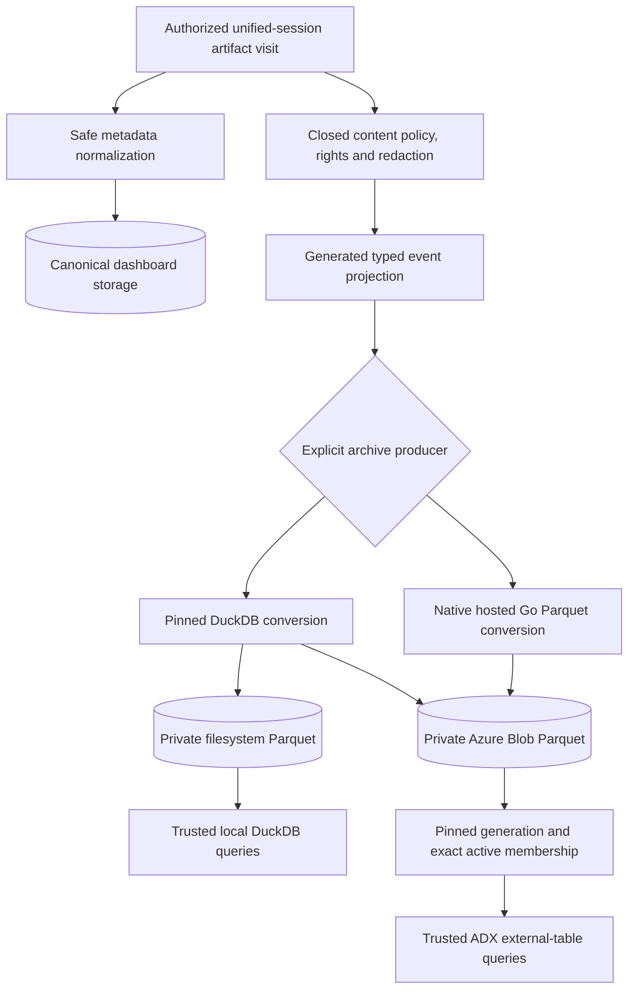

| Archive profile | Physical ownership and publication | Analytical access |
| --- | --- | --- |
| Local persistent host | Owner-only durable POSIX directory, whole-life lock, immutable Zstandard Parquet, atomic filesystem generations | Pinned DuckDB CLI reads authorized files; no persistent DuckDB event database |
| Legacy hosted persistent host | Private durable staging and pinned DuckDB conversion; immutable Blob objects/manifests, one Blob lease, conditional ETag-bound active pointer | Approved ADX external table over exact pinned Blob partitions and projection membership |
| Explicit native hosted producer | Bounded in-memory Go Parquet conversion; the same Blob ownership/publication boundary, metadata-only admission receipts, no POSIX staging or DuckDB | The same generation-bound ADX access, plus PostgreSQL source-epoch authority and final-delivery read locks |

`server/spec/trace.tsp` owns the closed logical event schema and generated
physical projection. Rows preserve approved payload structure, event order,
exact repository/run/attempt identity, lineage, policy/artifact digests and
recorded omissions. Complete approved capture is not unrestricted raw content
or a guarantee of complete upstream coverage. The native Parquet producer
supports full capture only; unsupported sampling fails closed.

Parquet is the retained evidence; **Azure Blob Storage owns hosted objects,
and Azure Data Explorer (ADX/Kusto) is the external-table query engine**.
This differs from the separately selected direct ADX canonical-snapshot and
unified-trace streaming exporters. Those exporters, the Blob archive, and
Application Insights telemetry are not interchangeable destinations.
Neither an ADX cluster nor its external table establishes archive publication:
queries must select the exact pinned object hashes and active projection
membership before analytical operations.

Capture acknowledges only durable verified publication, not conversion or
upload alone. Corrections replace active membership; withdrawal and lost
authorization override pinned reads and preserve replay fences. Archive
retention is independent of dashboard detail and source caches. Logical
exclusion is not immediate physical erasure: packed files, reader horizons,
recovery grace, Blob versions, backups and prior exports require reconciliation.
The native profile's PostgreSQL registration/withdrawal outbox stores only
source/destination privacy metadata, **never archive contents or manifests**.
It is not a cross-backend transaction or permission for a Blob-only read when
source authority is unavailable.

Archive status and queries use the separate authenticated
`/api/v1/session-archive/` endpoints. Full-trace-read requires explicit approval;
hosted readers additionally need a current OAuth session, fresh strong-authentication
assurance, an exact reader allowlist and POST CSRF protection. Ordinary dashboard
membership, administrator status, or Blob/ADX credentials alone are insufficient.
Trusted `timeline` and `summary` queries are bounded; local-only
Dashboard Language `session-query` uses `archive-events` scalar columns and
does not expose `PayloadJSON`, joins or arbitrary SQL/KQL. Hosted ADX does not
yet execute `session-query`. Queries never fall back to dashboard storage.

**Deployment qualification:** the archive is independently default-off and its
ADR remains proposed pending required acceptance evidence. Persistent
single-owner hosts are required; the Azure Functions platform-listener profile,
ephemeral/per-request hosts, standalone collection jobs and multi-replica
archives are unsupported. Hosted activation requires real Azure conformance
bound to the approved Blob/ADX destination, not a successful upload, simulator
or acceptance flag. The native producer does not activate the native collector,
which remains fail-closed pending its independent integration gates.

**Source:** [Session archive specification](https://github.com/githubnext/gh-cao/blob/main/specs/session-archive.md),
§§1-7; [Archive operator guide](https://github.com/githubnext/gh-cao/blob/main/server/SESSION-ARCHIVE.md);
`server/internal/sessionarchiveblob/services.go`;
`server/internal/server/session_archive.go`; [Private archive queries](dashboard-data-ingestion.md#query-the-private-session-archive).

## 6. Consistency, publication, and reactive reads

CAO offers **eventual evidence convergence**, with different atomicity
boundaries by backend. Later usage, completion, or safe-output observations
can enrich earlier sparse Run records.

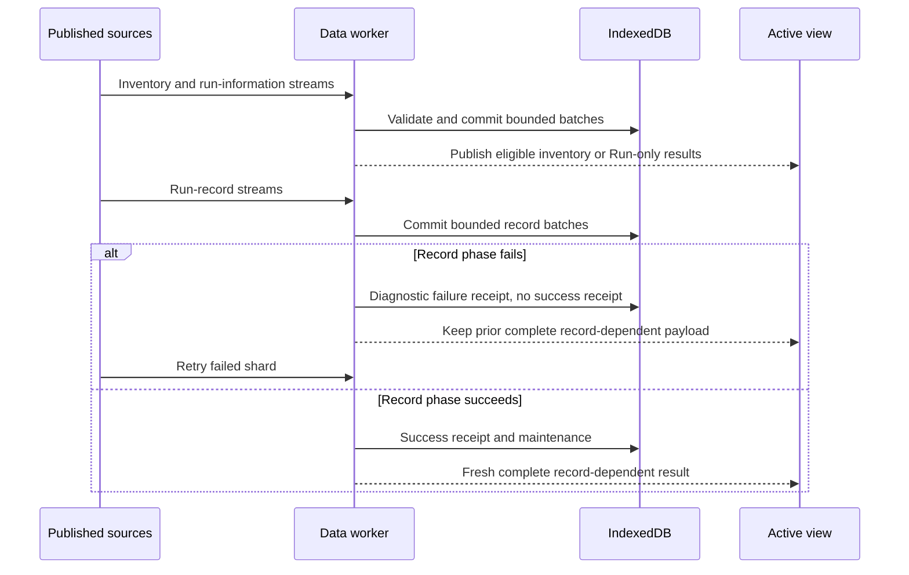

Browser canonical stores are **not generation-atomic**. A direct read during
ingestion can observe intermediate committed batches. Content-addressed
receipts allow retry and skip only compatible successfully ingested inputs.
An incomplete record phase never becomes a successful current snapshot.

Hosted PostgreSQL snapshot replacement commits **sources, diagnostics, and
revision atomically**. Query readers use repeatable-read transactions. Native
publication additionally fences enrollment and evidence digest in the commit.
Database errors or cancellation preserve the previous committed state.

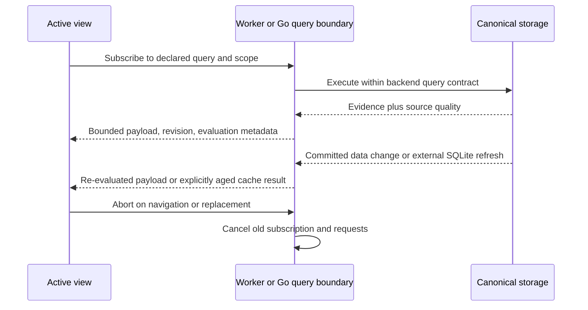

All filtering, joins, aggregation, sorting, pagination, and computation belong
to **Dashboard Language** in the worker or server query engine. UI effects
synchronize results and interaction state to owned DOM; they do not reconstruct
relationships or calculate business metrics. Hosted unsupported SQL shapes
fail closed, rather than executing a Go row-evaluator fallback.

**Source:** dashboard-data §§4, 5.2, 29-35, 43 and 73.

## 7. Cache coherency and evidence freshness

Separate **read-model revision**, **collection completeness**, and
**cache evaluation time**. A responsive dashboard is not proof of fresh or
complete evidence.

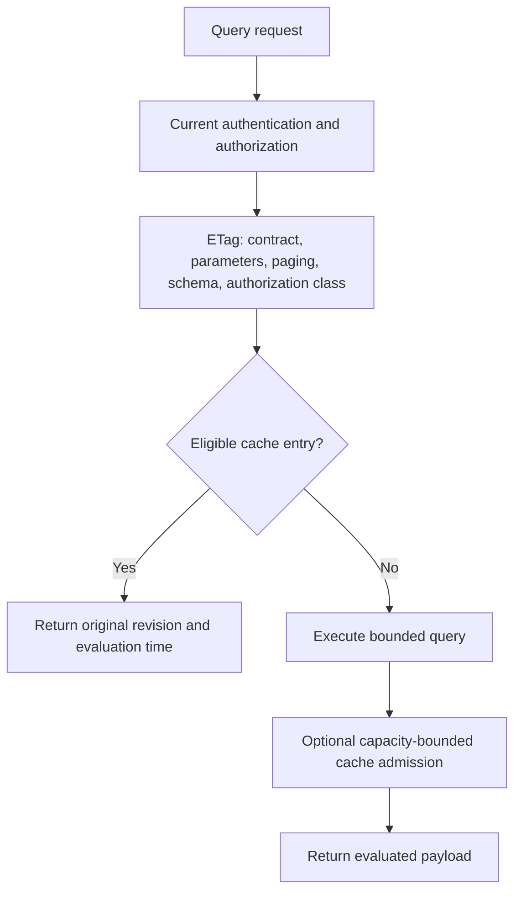

The Go query cache is optional cache-aside storage for expensive queries with
compact outputs. Entries expire **five minutes after admission**, without
sliding renewal. Their key excludes ingestion revision, and ingestion or data
egress does not invalidate them. Hits therefore retain the original evidence
revision and evaluation time; they are not newly evaluated evidence.
Canonical entity APIs and readiness probes do not use this result cache.

Capacity guards bound output bytes, entries, and adapter-specific accounting.
Redis has an additional whole-node memory-pressure contract; providers without
required atomic introspection disable disposable-cache admission and serving,
not protected operations. Cache pressure must not evict sessions, accepted
queue work, quota state, or pending revocations.

**Source:** dashboard-data Abstract; server operational storage contracts.

## 8. Retention, aggregates, and statistical evidence

Treat **exact retained detail**, **additive observations**, and **statistical
samples** as different products. They have distinct population, grain,
retention, and coverage contracts.

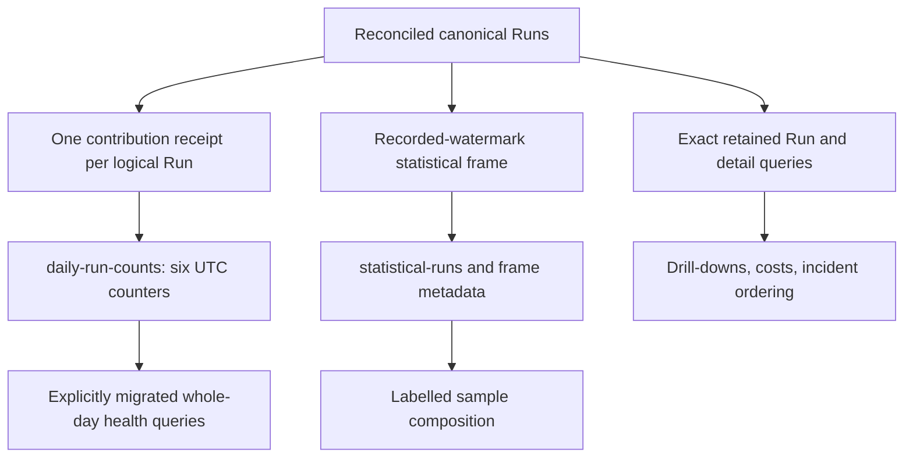

| Product | Architect's interpretation | Do not assume |
| --- | --- | --- |
| Retained Runs and run-owned detail | Exact queries over currently available evidence | Retention or capacity limits preserve all upstream history |
| `daily-run-counts` | Six counters for observed logical Runs at UTC day/Repository/Workflow grain | Arbitrary predicates, rollout mode, sub-day totals, distinct counts, tokens, or costs are supported |
| `statistical-runs` | Deterministic seven-day date/outcome-stratified frame at a recorded watermark | Unweighted sample counts or model shares estimate the population |
| Operational Value evidence | Independent metric/evidence lifecycle | Runtime success proves accepted outputs or realized business value |

Daily counters are `total`, `successful`, `failed`, `approval`, `pending`, and
`other`; the five exclusive classes sum to total. Corrections atomically remove
the old contribution and add the replacement. Replay and attempt changes do
not add another logical Run. Detail eviction does not subtract surviving
daily observations. The source retains the current UTC Monday-start week and
two preceding weeks, with a monotonic retention watermark.

Only explicitly migrated additive health consumers use this persisted daily
exception. They never union its totals with retained Runs or silently fall
back to detail. Missing readiness is unavailable, not an empty population.
Undated executions cannot be assigned to ingestion day.

The statistical layer selects before consumer filtering, with independent
capacities: PostgreSQL 64,000, SQLite 8,000, IndexedDB 16,000 selected Runs.
Only PostgreSQL persists frozen evidence bundles and parent closure;
incremental revisions mark them stale, and complete snapshot publication
rebuilds them. Browser and SQLite sampling cannot restore expired detail.
Sampling does not reduce canonical storage or download volume.

**Retention qualification:** the draft contains conflicting summary-retention
wording: §5 and the opening browser contract retain all available Run summaries,
while §41 describes a 30-day default. Both describe seven-day run-linked detail
and 365-day compact Operational Values, with independent Value evidence.
Do not turn these statements into a guaranteed archive horizon. Verify the
selected adapter's effective retention and capacity configuration and resolve
the normative discrepancy before promising historical coverage. This guide
does not silently choose a new retention policy.

**Source:** dashboard-data §§5.1.1, 37, 41, 72.2 and 73.

## 9. Tenancy, trust boundaries, and least privilege

A database namespace is a **data isolation boundary**, not a grant of
repository reach. Authentication, user authorization, enrollment, rollout
policy, and credential scope are cumulative checks.

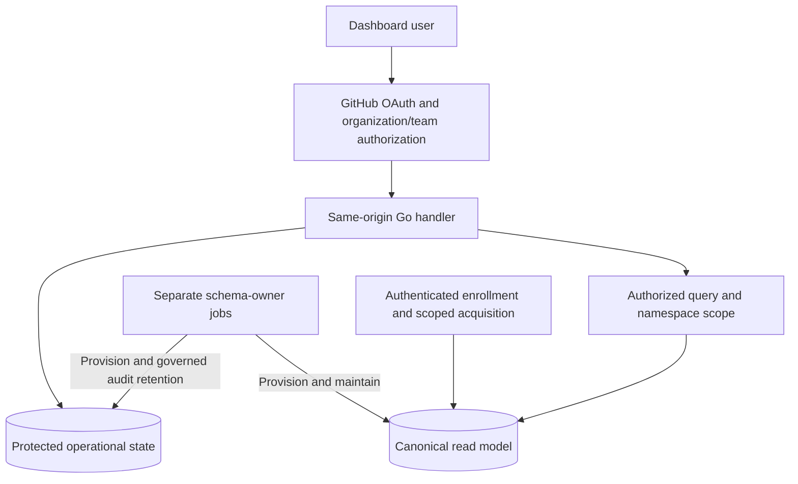

Runtime credentials open pre-provisioned state; they do not own tables,
perform arbitrary DDL, alter audit triggers, or truncate operational history.
Canonical bootstrap and UTC partition maintenance are separate operator jobs.
Non-loopback operational PostgreSQL connections require certificate-chain and
hostname verification, not encryption alone.

Minimize data **before publication**, not by hiding UI elements. Prompts,
raw tool arguments/responses, session bodies, and credential-bearing content
do not belong in ordinary canonical records. Separately approved archive or
trace destinations have their own admission and erasure contracts. Structured
telemetry retains safe identifiers, counts, timings, coverage, and provenance.

**Source:** dashboard-data §§5.2, 57-58; server operational storage;
server ingestion §2.4.

## 10. Resilience, disaster recovery, and capacity planning

Rebuildability is the read model's recovery strategy. It is **not** a backup
strategy for protected operational state or a guarantee that upstream
artifacts are retained forever.

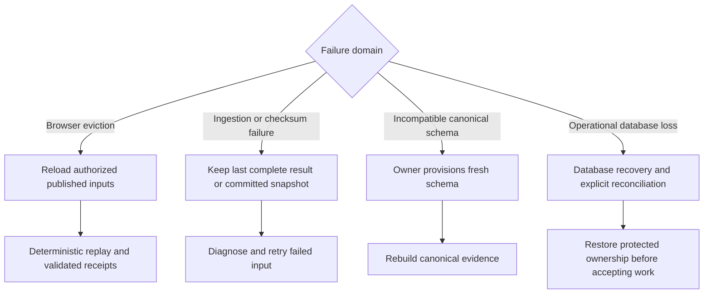

| Failure or limit | Required behavior | Operator implication |
| --- | --- | --- |
| Corrupt/hash-mismatched shard or broken relationship | Reject input; no success-shaped receipt | Alert on phase/source diagnostics and verify authoritative publication |
| Browser quota exhaustion | Abort failed transaction; reclaim disposable state or oldest complete Run subtrees | Monitor storage diagnostics; never leave orphaned detail |
| PostgreSQL publication failure | Roll back sources and revision | Preserve the previous committed snapshot; investigate writer/readiness state |
| Canonical capacity pressure | Evict oldest relationship-complete Run subtrees atomically, or reject if the newest cannot fit | Source coverage becomes partial; protected operational state remains independent |
| Acquisition quota or queue backpressure | Preserve delivery/attempt ownership and explicit incomplete state | Do not widen credentials or consume accepted work as a cache |
| Unsupported query or backend capability | Explicit unavailable/error response | Do not silently change query semantics or select another backend |

Hosted canonical limits include **200,000 rows per Run-owned source** and
**256 MiB combined logical typed-row bytes**. These are admission envelopes,
not physical PostgreSQL disk, index overhead, peak transaction memory, or RSS
budgets. Frozen statistical bundles have their separate record/byte envelopes.
Bounded batches, cancellation, deadlines, pagination, and query-plan budgets
contain the blast radius; they do not prove throughput.

Define deployment-specific **SLIs/SLOs** for evidence lag, ingestion success,
query latency, source completeness, queue age, and saturation. The specification
does not promise a numerical availability SLO, RPO, or RTO. Canonical recovery
time depends on retained authorized inputs and replay cost; operational RPO/RTO
depends on the database's durability, backups, and tested restoration. Verify
real adapter conformance and worker-isolate heap measurements, not only mocks
or aggregate process memory.

**Source:** dashboard-data §§32-41, 46-59 and 72.10;
server ingestion §§8-12; server operational storage.

## 11. Architecture review checklist

Before approving a deployment or boundary change, establish:

| Review question | Required evidence |
| --- | --- |
| Which acquisition profile owns writes? | Explicit profile selection, enrollment, credential and fencing configuration |
| Which serving/query backend is selected? | Synthetic-only Pages, real local SQLite, or production hosted `server-http`; no automatic fallback |
| Where are atomicity and durability promised? | Browser phase/receipt semantics versus PostgreSQL publication and protected-state contracts |
| What population does each metric describe? | Exact retained evidence, daily observations, or a labelled statistical frame |
| Is private full-session evidence separately approved? | Archive content/read grants, exact scope, fenced Parquet membership, independent retention and real destination acceptance |
| How is current authorization enforced? | User scope before query/cache lookup; separate enrollment and execution authority |
| What survives eviction, retention, or rebuild? | Effective retention, coverage metadata, protected state, and tested recovery boundaries |
| Who provisions and maintains storage? | Separate owner jobs, least-privilege runtime roles, UTC partition readiness |
| What validation proves backend behavior? | Production-boundary fixtures, real-browser and real-PostgreSQL conformance, failure/cancellation cases |

## 12. Document ownership and maintenance

`self-care-database-architecture` maintains this page as a **SelfCare worker**.
The existing orchestrator supplies at-most-once-per-rolling-24-hours eligibility;
the worker has no separate cron and stops while its documentation PR is open.
It compares current authoritative sources and relevant implementation evidence,
not just the previous day's commit messages.

Material architectural drift produces at most one documentation-only draft
PR for human review. Accurate documentation produces a no-op; source conflicts
remain explicit qualifications rather than invented behavior. A daily check
does not guarantee a daily PR or a successful run when Actions, credentials,
policy admission, or required validation are unavailable.

## 13. Azure service mapping

Map **domain services to deployment resources**, not every interface to a new
Azure product. The experimental `server/azure/main.bicep` baseline composes the
Go service on Azure Functions with PostgreSQL for both analytical and operational
adapters. Optional resources and operator-managed analytics remain separate
decisions; this map neither provisions them nor authorizes production use.

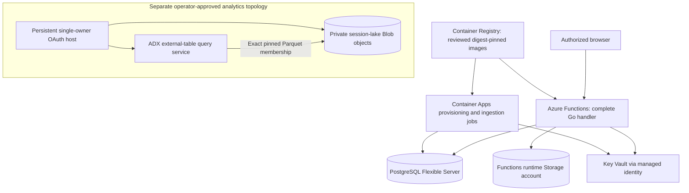

| Domain responsibility | Azure service mapping | Provisioning and capability boundary |
| --- | --- | --- |
| Same-origin UI, OAuth, query APIs and revision events | Azure Functions custom Linux container on an Elastic Premium App Service plan | Baseline hosts the complete Go handler; GitHub remains the OAuth and membership provider, not Entra. No separate frontend or browser database credentials |
| Canonical entity/query adapter | Azure Database for PostgreSQL Flexible Server | Private delegated subnet and verified TLS; typed canonical tables are a rebuildable read model, not raw-session storage |
| Focused operational services: OAuth sessions, revocations, queues, leases, quotas, deduplication and durable audit | The same PostgreSQL Flexible Server through the separate operational adapter | `cao_operational_*` tables retain separate lifecycle, atomicity and protected-state bounds. Baseline requires neither Redis nor Azure Service Bus; they are not implied adapter substitutions |
| Schema ownership and selected snapshot ingestion | Separate manual Azure Container Apps provisioning and ingestion jobs | Distinct identities and owner/runtime credentials; explicit verified snapshot or empty evidence. Jobs do not become archive publishers |
| Optional collection and backfill | `collector.bicep` Container Apps and backfill job when explicitly configured | Separate enrollment, acquisition profile and durable ownership gates; provisioning a worker does not activate native acquisition or authorize more repositories |
| Image distribution | Azure Container Registry, managed-identity pulls | Baseline builds/selects Functions, provisioning and ingestion images; digest pinning alone is not production scan, SBOM or provenance assurance |
| Secret resolution | Azure Key Vault and managed identities with secret-scoped roles | Secrets remain outside policy and browser payloads. Managed-identity Key Vault access does not itself authenticate Blob/ADX archive adapters, which require their separately configured application credentials |
| Functions platform state | Azure Storage account | Runtime state only, **not the session lake**. A private archive Blob root, content approval, credentials and publication lifecycle are separate operator configuration |
| Private unified-session lake: `BlobStore` | Private Azure Blob Storage for immutable Parquet, manifests, lease and conditional pointer publication | Operator-managed, independently default-off; not provisioned or enabled by the Functions runtime storage resource. Use an approved persistent single-owner host, not the Functions platform listener |
| Private lake analytics: `QueryService` | Azure Data Explorer external table over approved Blob Parquet | Real destination-bound conformance, exact generation membership and runtime/setup role separation are mandatory. `adx.bicep` optionally provisions a paid cluster/private endpoint with `adxEnabled=true`, but no external table, exporter or archive activation |
| Direct canonical-snapshot or unified-trace analytics | Separately selected ADX streaming exporters | Independent scope, approval, durable state and single-exporter gates; not Blob archive queries and not supported on the Functions platform-listener profile |
| Operational observability | One shared Log Analytics workspace and workspace-backed Application Insights component | Container logs and configured telemetry, not session-lake content or canonical query storage. Go telemetry requires an explicitly configured operator-managed OTLP collector; host Insights settings alone do not enable Go export |
| Private database/destination connectivity | Virtual network, delegated subnets, private DNS; optional ADX private endpoint | Database, Functions and Container Apps access are separated. ADX needs its own reviewed network/DNS path; a private endpoint is not a data-access grant |

**Provisioning is not activation.** The baseline Storage account cannot be
relabeled as a lake, and enabling `adxEnabled` does not inject exporter settings,
grant runtime data roles, install archive external tables or satisfy single-owner
and acceptance gates. Review backup/retention, cost, network reach, privacy
cleanup and live adapter evidence for each selected service independently.
Managed service names alone promise no HA, numerical SLO, RPO/RTO or compliance.

**Source:** [Azure deployment guide](deployment-azure.md#azure-resources) and
[optional ADX destination](deployment-azure.md#optional-azure-data-explorer-destination);
`server/azure/main.bicep`, `network.bicep`, `provisioning.bicep`,
`ingestion.bicep`, `collector.bicep`, `function-roles.bicep`,
`worker-roles.bicep`, and `adx.bicep`;
[Operational contracts](https://github.com/githubnext/gh-cao/blob/main/specs/server-operational-storage.md#contracts-and-composition);
[Archive service adapters](https://github.com/githubnext/gh-cao/blob/main/server/internal/sessionarchiveblob/services.go).

Continue with [Data ingestion](dashboard-data-ingestion.md),
[Data model](dashboard-data-model.md), and [Dashboard Language](dashboard-language.md).
For implementation decisions, consult `ARCHITECTURE.md` and the normative
[data](https://github.com/githubnext/gh-cao/blob/main/specs/dashboard-data.md),
[ingestion](https://github.com/githubnext/gh-cao/blob/main/specs/server-ingestion.md),
[operational storage](https://github.com/githubnext/gh-cao/blob/main/specs/server-operational-storage.md),
and [computation](https://github.com/githubnext/gh-cao/blob/main/specs/computations.md)
contracts at the revision being changed.
