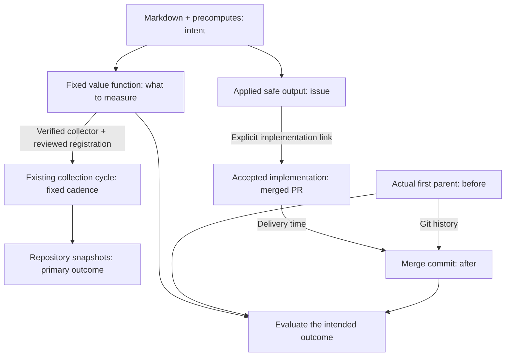

We measure **operational value** by checking whether a workflow's intended
repository outcome was attained—not whether a run succeeded or produced output.
This guide assumes you know workflow Markdown, precomputes and safe outputs.

**Intent defines what we measure. A fixed cadence tracks the repository;
acceptance anchors each linked contribution.**

## Define the value function

Read the workflow's Markdown, imports and precomputes for its goal, selection
rules and acceptance checks. Turn these into a **value function: a fixed rule
that measures the intended repository outcome**. Agree on scope, units and
missing-evidence rules before examining results.

For Daily File Diet, the goal is smaller production files without broken
behavior. The saved retrospective measure counts non-test Go files under `pkg/`
with at least 800 lines; lower is better. This is distinct from the original
1,000-line issue-creation trigger. Tests and other quality checks remain required
for full acceptance.



## Measure regularly, and at acceptance

Measure the primary repository state at a fixed cadence, including periods
with no accepted output. This reveals growth, recovery and reversals regardless
of who changes the repo. Measuring only at merges would select for completed
work and miss what happens between them.

Track the safe output's actual issue or PR through its lifecycle. For a proposal,
follow explicit links to the accepted implementation. Its merge time
locates the **actual first parent** and **merge commit** for before/after checks.
Apply the fixed function to all eligible files, including replacements; count
each PR once. If acceptance requires later evidence, wait for that maturation
period. Pending or rejected outputs are not delivered improvements.
Acceptance times vary: keep each opportunity's start and acceptance times,
report pending work and its age, and compare cohorts with equal follow-up.
Unresolved work is not automatically zero or failure. Retain zero and negative
changes at accepted merges, too.

For example, [github/gh-aw#55785](https://github.com/github/gh-aw/pull/55785)
links to [github/gh-aw#55776](https://github.com/github/gh-aw/issues/55776).
Between its [parent](https://github.com/github/gh-aw/tree/27092a4090300be16379f12fa5d60b36c04da832)
and [merge](https://github.com/github/gh-aw/tree/50f4e1baafb070f8426566f5bfcdc0f5bf476011),
`pkg/cli/add_command.go` shrinks from **1,129 to 248 lines**, with four smaller
files added. This proves a structural change, not unchanged behavior.

## Interpret the measurement

In the [saved File Diet report](https://raw.githack.com/githubnext/gh-aw-cao/refs/heads/mnkiefer-workflow-operational-value/docs/operational-value/gh-aw-workflows/daily-file-diet-pulse.html)
(October 18, 2026), select an event to inspect its issue, PR and Git revisions.

- **Primary measure:** the repository's oversized-file count, regardless of who
  changes it. It grows from 16 to 53.
- **Diagnostic:** verified reductions at linked merges. There are 48 over the
  workflow's lifetime. Useful repairs can coexist with a growing problem.

The skill's report follows **workflow intent → safe outputs → accepted changes
→ measured result**, with source links for the consolidated intent. It separates
retained proposals from receipt-confirmed creation and linked implementations:
closing an issue alone is not acceptance. Repository state includes everyone's
work; recent results remain separate from historical contribution. Unverified
quality checks stay visible. Select a headline number for its exact evidence;
chart points reveal the counted files with links at the measured Git revision.
Dashed lines guide the eye between snapshots, not continuous observations.
The plot states which direction is better; signed change shows whether the
repository problem improved or worsened since the first snapshot.
**Explore evidence** links each result to its issue, merged change, before/after
files and measurement rules. Historical reductions
do not mean that many fewer files remain today.

**Review results** asks for inspection, not retirement. **Check evidence** means
the comparison is not established; **No review triggered** is not an all-clear.
Future alerts must distinguish worsening outcomes, overdue acceptance and
missing evidence rather than treating every quiet period as failure.

**Lineage plus time-aligned measurements connect outputs to observed outcomes;
timing alone does not prove causation.** A merge is not proof of every quality
requirement. Missing evidence is unknown, not zero.

Use `/add-operational-value OWNER/REPO WORKFLOW` to design and verify a measure
with the skill. It gathers tracked outputs, verifies available producer
evidence, follows dated implementation links and measures the accepted Git
revisions. Reuse that fixed definition for subsequent evaluations.

To keep it current, the skill automatically stages its exact registration after the frozen function
and bounded collector pass verification; no separate enable step is needed.
Review, commit and deploy the policy and collector together. Activity shows its
real collection health even before a first capture. Recurring remote acquisition
remains deferred until shared API budgets can be enforced; registration alone
does not guarantee fresh measurements. Bounded local-only computations run
separately without holding up ordinary publication. Failures and deferrals
keep the last capture; disabling collection keeps history. For a one-time
hosted upload, use `gh cao value publish ... --server URL --input REPORT-evidence.jsonl`;
uploading alone does not enable collection.
See [publication and recurring collection](operational-value.md#recurring-collection-after-opt-in).

> [!IMPORTANT]
> A current report requires fresh evidence collection, not just rerendering.
> The skill includes File Diet acquisition and offline replay commands.
> The linked October 18 example remains a saved historical report.

For research, limitations and exact replay commands, read the
[long-form blog article](/gh-cao/blog/measuring-agent-work-value/).

## Native reports from retained evidence

The native path is **retained originals → frozen evaluator → original evidence
envelope → canonical storage → Dashboard Language → Value**. It does not load
the standalone HTML. From a CAO source checkout, recompute the saved File Diet
proof without contacting GitHub:

```sh
node .github/skills/add-operational-value/examples/native-file-diet.mjs \
  --proof PATH_TO_RETAINED_PROOF --output .tmp/file-diet-native
npm --prefix dashboard/site run build
cd server
go run ./cmd/cao-dashboard serve --backfill=false \
  --sqlite ../.tmp/file-diet-native/dashboard.sqlite
```

Open the server's private local launch URL, then the `reportRoute` or
`workflowRoute` in `.tmp/file-diet-native/manifest.json`. The manifest records
input digests and sizes, original capture/cutoff, stage timings, parent-process
peak RSS and the canonical packet identity. It does not claim child-process
RSS, cold-disk performance, new capture, or deployment. `--evidence FILE
--sha256 DIGEST` instead reuses an already verified original envelope in a new
output directory; it does not recompute inventory measurements.

For another workflow, freeze the repository-native primary measure separately
from any output-linked diagnostic before implementing this same boundary:

Use `/add-operational-value OWNER/REPO WORKFLOW` to recover immutable Markdown,
imports and precompute intent, probe the pre-adoption outcome, and review the
frozen contract. Verify the evaluator and bounded collector before the skill
stages the exact opt-in registration. Keep explicit disables and Activity
scope unchanged. Arbitrary intent text is not executable scoring logic and
does not by itself establish a measurable outcome.

Any verified contract's original envelope can use the shared native importer;
File Diet's recomputation example calls this same implementation:

```sh
node .github/skills/add-operational-value/scripts/prepare-native-value.mjs \
  --input REPORT-evidence.jsonl --sha256 VERIFIED_SHA256 \
  --output .tmp/workflow-native-value
```

The required contract includes exact repository/workflow identity, metric
ID/version, role, native unit, direction, formula, cadence, maturation, coverage
and missingness. Retain independent snapshots, optional accepted contributions
and unverified quality separately. Both the generic importer and hosted
publication reject invalid originals without enrolling or executing a
workflow; collection health remains separately published policy/attempt evidence.

| Input | Retained location and join | What it proves |
| --- | --- | --- |
| Intent and measurement rule | Immutable workflow/import revisions and versioned evaluator | Population, threshold, cadence and acceptance requirements |
| Independent repository inventories | Revision, file path, Git blob ID, captured newline/byte measurements | State at each retained snapshot, including everyone's changes |
| Origin and lifecycle evidence | Output node ID; exact producer repository/run/attempt; receipt digests | Applied creation only when an actual receipt verifies it |
| Accepted implementation | Distinct PR node ID, merge time/revision and actual integration parent | Accepted code delivery, not every quality check |
| Session history | Private archive generation and projection, exact repository/run/attempt, ordered events | Approved retained session context, not a Git baseline or acceptance proof |

File Diet keeps `oversized-files` / `observed-800-line-snapshot-v1` as the
primary: regular non-test Go files recursively under `pkg/` with at least 800
newline characters, lower is better. The separate
`oversized-files-reduced` / `observed-800-line-net-reductions-v1` diagnostic
subtracts the accepted revision's count from its actual parent's count,
including replacement files. Deduplicate implementations before crediting
many-to-many output links, and retain zero and negative effects. Replaying
archived counts and hashes is not remeasuring Git blob contents.

### Parquet is retained session evidence, not the outcome database

With an already approved populated archive, add `--archive-server ORIGIN` to
the proof command. The shared `scripts/session-archive.mjs` reader uses only
authenticated status and exact trusted timeline routes. It joins retained
producer references by exact repository/run/attempt, reuses each requested
timeline within the batch, and verifies generation, projection, ordering and
response bounds before accepting a link. It never enumerates the repository's
session summary to resolve already known producers, so unrelated workflows
cannot exhaust a summary limit before an exact read. Unknown attempts and absent traces
remain explicit; changed generations, denial, withdrawal, malformed responses
and exhausted budgets fail without fallback or GitHub recollection.

The same API reads local Parquet with pinned DuckDB or private Azure Blob
Parquet with generation-bound ADX. It accepts no SQL/KQL, paths or historical
generation overrides. `CAO_VALUE_ARCHIVE_TOKEN` is a local bearer capability,
not permission to enable full-content capture. Hosted readers provide their
existing OAuth/CSRF headers through the shared reader's header callback and
remain subject to the separate full-trace reader approval.

Private `archive-links.json` retains only linkage/digest metadata, not raw
payloads, and is **not** a public dashboard shard. It does not modify the
frozen canonical value packet or turn a trace into an applied receipt.
An absent/disabled archive can still support an explicitly historical report
from preserved Git/lifecycle evidence, but cannot establish Parquet coverage.
The October 18 proof was not acquired from this archive. Its first snapshot is
at adoption, not a pre-adoption baseline; its sparse snapshots are not daily
coverage. Captured relationships are not independently delivered webhooks,
and behavior preservation remains unverified.

### Resource isolation and publication

Recomputation is an explicit bounded offline action, never a navigation side
effect or work under the core projection lease. The reader limits individual
responses to 4,096 rows, 8 MiB and 30 seconds, and the proof linkage batch to
130 calls, 16 MiB and two minutes. These are admission limits, not capacity
estimates; separate processes alone do not isolate CPU, disk or API quota.
Native exact workflow/report reads use packet indexes before expanding facts.
Unscoped local/browser populations over 32 packets, 16 MiB or 20,000 facts fail
explicitly and require narrower scope, rather than expanding the entire fleet.
Global fleet summary pagination remains a distinct limitation of that gate.

Keep opportunity, acceptance/maturation, snapshot, capture, recomputation and
publication clocks distinct. Pending is not failure; missing, partial, stale
and zero are not interchangeable. Reuse never advances capture or cutoff.
An explicit hosted `gh cao value publish` sends the original envelope to the
authorized PostgreSQL publication API; static publication uses normal Activity
normalization and the reviewed Dashboard/Documentation deployment. Local
verification, a commit, or an uploaded archive object proves neither hosted
availability nor recurring collection. Shared-budget deferral remains in force.
