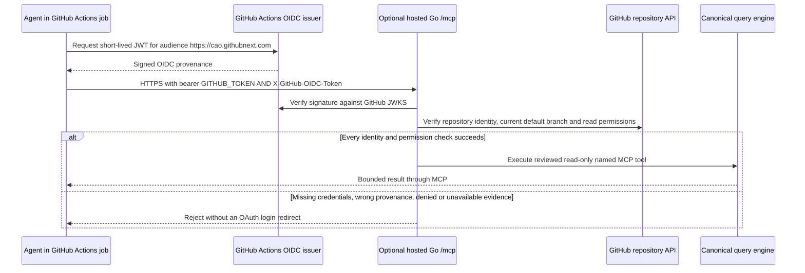

# GitHub Actions agents accessing hosted MCP

This is the existing hosted Go server authentication contract, not an enabled
endpoint or a new credential broker. Topology generation does NOT enable MCP,
grant workflow permissions, configure a caller repository, or widen ingress.

## Trust and request flow



**OIDC alone is not sufficient.** Every hosted Actions request needs both:

```text
Authorization: Bearer <this job's ephemeral GITHUB_TOKEN>
X-GitHub-OIDC-Token: <signed short-lived GitHub Actions OIDC JWT>
```

Use the SAME workflow job for both credentials. Configure the MCP client's
per-request HTTP headers; environment interpolation is client-specific, so do
not send placeholder strings as literal headers.

## Workflow-side prerequisites

The approved workflow needs these permissions, and no repository write grant
is implied by permission to mint an identity token:

```yaml
permissions:
  id-token: write
  actions: read
  contents: read
  issues: read
  pull-requests: read
```

Request a fresh JWT with the fixed audience **https://cao.githubnext.com**,
using the job's `ACTIONS_ID_TOKEN_REQUEST_URL` and
`ACTIONS_ID_TOKEN_REQUEST_TOKEN`, or the supported Actions toolkit. The audience
is NOT the deployment hostname. The supported issuer is
`https://token.actions.githubusercontent.com`.

Keep tokens only in the Actions process environment/memory and refresh them
when necessary. Never put either token in a URL, command-line argument, Git,
workflow output/artifact, log, generated parameter file or Key Vault. These
short-lived workload credentials are not persistent bootstrap secrets and
must NOT be added to `azure.secrets`. No GitHub App private key or PAT is
required for this MCP path.

## Server-side prerequisites and exact checks

- On a compatible process-owned host, explicitly opt in with
  `cao-dashboard serve-hosted --mcp-enabled` in addition to the existing TLS,
  PostgreSQL, host-policy and OAuth configuration.
- Set `CAO_MCP_ACTIONS_REPOSITORY=OWNER/REPOSITORY` to the one reviewed caller
  repository. Do not infer this authority from collection App installations,
  image registry access, a token's reach, or the data stored in PostgreSQL.
- Validate the RS256 signature/JWKS, issuer, exact audience, actor and time
  claims. The current verifier permits at most a ten-minute issued lifetime.
- Fetch live repository metadata and require matching repository and owner
  IDs plus the signed ref and supported subject for the repository's CURRENT
  default branch. The branch is not assumed to be named main.
- Pull-request, environment and non-default-branch subjects are rejected by
  this contract. Do not claim workflow-SHA pinning that this MCP verifier
  does not implement.
- Independently verify the bearer token can read Actions runs, contents,
  issues and pull requests in that repository. Missing/denied GitHub evidence,
  invalid/expired tokens or mismatched provenance fail closed.
- The hosted actor comes from signed OIDC provenance. `X-GitHub-Actor` is not
  a substitute; that header belongs to the separate local Actions gate.
- Verify runner-to-host HTTPS connectivity separately. Private hosts require
  approved runner/network reachability. Do not widen source CIDRs or expose
  a private service merely to make the sample connect.

The unchanged **Azure Functions baseline does NOT wire hosted MCP**:
its `azure-functions` entrypoint does not expose `--mcp-enabled` or populate
the MCP configuration. Setting the caller-repository environment variable
alone does not register `/mcp`. A reviewed hosting-composition change or a
compatible `serve-hosted` deployment is required; this generator makes neither
change automatically. The same limitation applies to the Functions front end
in the full Azure sample.

## Access and authority boundaries

The server exposes reviewed `cao_catalog` and `cao_query` tools, not arbitrary
SQL/query definitions, refresh/rebuild, repository writes, dispatch or rollout
authority. `cao_logs` and the protected `/api/admin/logs` diagnostics require
separate `CAO_SERVER_LOGS_ENABLED=true`; they are not enabled by this document.
MCP responses are `Cache-Control: no-store`.

The caller-repository proof authenticates the reader; it does NOT automatically
filter the deployed dataset to that repository. Review the server's data scope
and reader trust separately.

Browser administrators use GitHub OAuth sessions and CSRF protection instead
of this two-token Actions flow. The `/api/admission` and `/api/token-broker`
OIDC protocols are independent authorities; MCP authentication never authorizes
their mutations, billable token issuance or credential exchange.

## Acceptance TODOs

- [ ] Confirm the chosen host actually registers `/mcp`; never infer this
  from Bicep validation or successful dashboard browser sign-in.
- [ ] Approve the exact caller repository, workflow permissions, data scope
  and runner network path independently.
- [ ] Verify a current-default-branch job succeeds with BOTH credentials.
- [ ] Verify missing bearer, missing OIDC, wrong audience/repository/branch,
  expired provenance and denied read permissions are rejected.
- [ ] Verify tokens do not appear in URLs, logs, artifacts or stored secrets.
- [ ] Verify named-query scope/bounds and absence of mutation capabilities.

Authoritative implementation and operator contract at the generating revision:
`server/internal/server/actions_oidc.go`, `actions_auth.go`, `mcp.go`,
`hosted.go`, and
[server MCP setup](https://github.com/githubnext/gh-cao/blob/main/server/README.md#local-mcp-endpoint).
