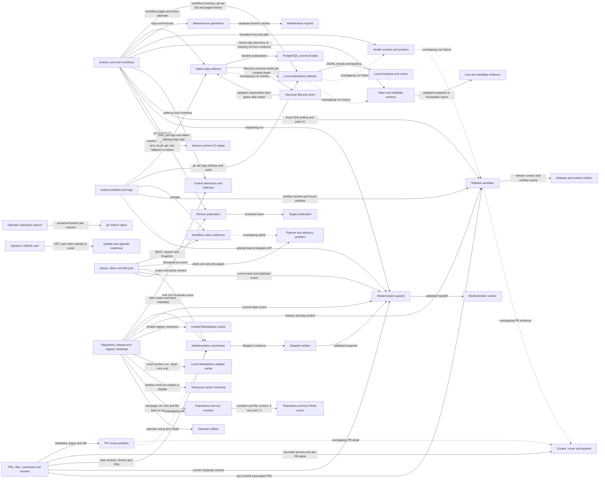

# Central Agentic Ops Data Acquisition Audit

**Version:** 1.0.0  
**Status:** Working Draft  
**Audit date:** 2026-11-19

## 1. Scope and method

This source-based inventory covers production GitHub REST, Search and GraphQL reads, `gh aw logs`, artifact downloads, prefetches, indexes and caches in the catalog and its Go runtime. Editable workflow Markdown, conventional Actions workflows, JavaScript, shell, Go, graders and setup utilities were inspected; generated locks are manifestations, not independent collectors. Tool availability is not proof of a call, and configured bounds are not measured traffic. Actual request totals depend on scope, events, access and returned pages.

The legacy Activity publisher, dashboard-artifact workflows and their shared cache are retired; historic entries in the [refresh ledger](./data-acquisition-audit-history.md) are not current architecture. Hosted dashboards use Go and PostgreSQL; Pages is a synthetic-only demo, not an operational source. Explicit operational JSONL artifacts remain supported. See [architecture](../ARCHITECTURE.md) and [server ingestion](./server-ingestion.md).

## 2. Acquisition inventory

| Producer and trigger | Acquisition, bounds and output | Reuse and completeness |
| --- | --- | --- |
| Local repository search (`internal/cli/dashboard_repository_search.go`, `server/internal/server/repository_selector.go`) | On demand, the local dashboard adapter's `POST /repositories/search` runs one `gh search repos --owner` query per request (limit 1–50, 15-second timeout, 1 MiB output) and returns the result without caching. | Repeated operator searches are not deduplicated and consume Search quota. Each request is independent of collection and cannot satisfy history or evidence reads. |
| Local `gh cao dashboard` / `dashboard collect` (`internal/cli/dashboard_collect.go`, `dashboard_backfill.go`, `dashboard_logs.go`, `dashboard_serve.go`) | One rotating repository per pass: exact repo lookup, workflow inventory (limit 1,000), `gh aw list --repo ... --json`, recent `gh run list`, cursor-paged `actions/runs` history, then `gh aw logs --artifacts all --audit --format jsonl` for observed workflow paths. Defaults: 200 runs, seven-day window, five-minute refresh; the logs command has a two-minute timeout. | A 500-request pass allowance and live core reserve of `max(1000, ceil(limit/5))` are rechecked before admitted commands. The wrapper reserves pages from `--limit` or one request otherwise, including for `gh aw list`; it does not establish that command's internal request count or pagination. Invalid list output, a non-GitHub host or a command failure preserves the previous snapshot. Campaign membership is read only from the local checkout; remote membership and source provenance remain unknown. History uses closed windows and at most 100 results per page; windows over GitHub's 1,000-result cap split, and an unsplittable creation second fails incomplete. Checkpoints survive quota pauses. A newest-first, 5,000-run artifact backlog retries unfinished enrichment and skips current attempts; artifact ceilings are reported as partial. Managed JSONL cache is bounded to 256 MiB; open-ended listings refresh. While backfill is incomplete, passes can recur after two seconds; quota pauses wait toward reset (bounded by normal refresh), watching/failed states use normal cadence, and unreadable or failed ingestion state with no runs retries within 30 seconds. |
| Native App collector (`server/internal/collectnative/`, `server/internal/collect/run_enumeration.go`, `server/internal/collect/backfill.go`) | When explicitly configured, installation-scoped native Go collection replaces subprocess acquisition. Historical discovery pages workflow registry and then each `.lock.yml` workflow's runs within frozen UTC bounds; each admitted attempt is checked by exact run/attempt, then artifact pages and allowlisted ZIPs are fetched. Attempt job pages and completed, non-skipped job logs are also acquired for audit evidence (`jobs.go`); failed attempts additionally request exact-attempt step-log archives (`audit_validation.go`). Native inventory additionally reads repository metadata, default-branch commit, latest compiler release, workflow pages and lock contents (`inventory_github.go`). | Durable enrollment-epoch and receipt-fenced tasks, publication intents and installation quota protect scope and progress. Native history rejects a filtered workflow result above 1,000 or incomplete pagination rather than pretending completion. Defaults include 100 pages, 100 artifacts and 32 MiB per acquisition; archive entries and lines are bounded (`evidence.go`). Inventory stops at ten 100-item pages and records incomplete coverage. No blanket conditional-read cache is assumed. The legacy repository-wide `enqueueHistoricalRuns` branch in `backfill.go` is not the native discovery path. |
| Native lifecycle outcome refresh (`server/internal/collect/lifecycle_refresh.go`, `server/internal/githubapp/outcomes.go`, `server/internal/postgresx/acquisition_outcomes.go`) | Outcome and status webhooks enqueue a debounced (15-minute) lifecycle task; each scheduled reconcile pass enqueues a `lifecycle-repair` task when `Due` finds created issue/PR targets older than the lifecycle interval (default 24 hours, floor one hour), so repair cadence follows the reconcile interval (default one hour). Each pass selects up to 25 distinct target URLs and makes one authoritative `GET` of the issue or pull request per target, then continues while more remain. Webhook-triggered passes force-refresh the first batch rather than applying the staleness cutoff. | Reads go through the installation-scoped client and quota reservation. A successful read advances each target's adoption observation time past the daily cutoff, so repair re-reads a target at most about once per interval. Failed or non-GitHub-API evidence aborts the pass rather than recording a result. Outcome records are capped at 20,000 rows and 16 MiB. |
| App scope repair (`server/internal/collect/discovery.go`) | Scheduled installation enumeration and per-installation repository pages, hourly by default, independently of webhook delivery and cold-start scope discovery. | Shared quota applies; repeated full enumeration can scale with installations and repositories. Durable scope is authority, not a discovery cache. |
| Workflow Value (`server/internal/collect/projector_remote_value_*.go`, `.github/value-collectors/`, `.github/skills/add-operational-value/`) | Explicitly registered File Diet evidence uses bounded Search, issue/PR lifecycle REST and GraphQL, source commits and Actions artifact receipts; Dependabot evidence uses cursor-paged alerts and bounded PR Search under a 111-request grant. | File Diet's incremental proof reuses retained immutable evidence but refreshes mutable relationships. The native reader memoizes within an acquisition and enforces reviewed requirements and budgets; core, search and GraphQL are distinct quota pools. Missing, capped or inaccessible evidence must not become complete evidence. |
| Control admission and dispatch (`.github/workflows/shared/control.md`, `control.mjs`) | Each importing run checks out control `.github` at workflow SHA and resolves policy, quota, repository and workflow inventory through injected Octokit; `gh api --cache 60s` is a fallback. Workflow inventory pages 100 at a time and rejects more than 10,000. Manual debug actor permission is deliberately rechecked at admission and precompute. | Per-run work is isolated; workflow inventory can use a separate credential. Preserve exact-SHA policy and fresh authority checks, even where other reads can be reused. |
| PR review prefetch (`shared/pr-review-context.md`, `design-decision-gate.md`, `mattpocock-skills-reviewer.md`, `test-quality-sentinel.md`, `service-architecture-reviewer.md`) | Each invocation reads PR metadata twice, paginates changed files and review comments, and fetches the diff only for at most 300 files; the emitted general and test patches are each capped at 3,000 lines. The architecture reviewer adds bounded head/base architecture reads. All four reviewers also run on `ready_for_review`, with distinct path filters, as well as their configured slash commands. | Prefetch code is shared, not results; a qualifying PR can trigger several independent acquisitions. File-count mismatch, API failure or changed head fails the prefetch; truncated or unavailable evidence must not be used as complete review evidence. |
| Repository queues and maintenance (`pr-sous-chef.md`, `repo-assist-*.md`, `dreaming-agents-md-curator.md`, `self-care.md`) | Sous Chef polls up to 50 non-draft labeled PRs every 30 minutes and shortlists up to four; repo-assist separately scans bounded issue/PR queues. Curator lists recent merged/open PRs and then per-PR comments/files. SelfCare checks recent worker runs for cadence. | Fixed-schedule scans and full-history checkouts are independent; per-PR detail is N+1. Some maintainers retain private cursors, but they do not share an evidence snapshot. Cadence checks fail closed on ambiguous history. |
| Incident, status and cost evidence (`cao-evolution-failures-investigator.md`, `cao-framework-health.md`, `daily-repo-status.md`, `optimization-token-auditor.md`, `cao-evolution-reliability.md`) | Failure investigation pages up to five run-history pages and details at most five failures with bounded log tails. Framework health and daily status independently read bounded recent runs, jobs, issues and related metadata. The token auditor requests independently discovered completed runs for seven full UTC days; reliability requests missing bounded evidence for 24 full hours. | Overlapping Actions windows are re-read across runs and graders. The workers may reuse explicitly validated snapshots, but missing run or cost coverage remains incomplete; agent-directed fallback call counts are not fixed by source. |
| Security and dependency prefetch (`dependabot-update-planner.md`, `uk-ai-advisory-operational-resilience.md`) | The planner validates target and visibility, then follows alert `after` cursors at 100/page up to 100 pages, writing a run-local evidence file. The advisory worker reads bounded repository, recent commits, security issues and scanning/Dependabot alerts. | The planner marks rate limits, invalid cursors and exhausted pagination unavailable rather than complete. The advisory's independent bounded alert pages overlap the planner's evidence but may have different coverage and access. |
| Rule mining and graders (`eslint-rules-miner.md`, campaign `.github/graders/`) | Miner reads one bounded merged-PR search page, commits, then files/comments for up to ten PRs. Dependabot grader reads a parent, sub-issues and per-child comments/timelines; docs and failure graders read Actions history; EU CRA grader reads ledger commits, associated PRs and reviews. | Candidate detail is N+1 and evidence is not shared across evaluators. Some miner command failures yield empty outputs; absence must not be interpreted as verified absence. Graders are conditional evaluations, not a retired scheduled Activity publisher. |
| Modernization coordinator and guard (`.github/workflows/modernization.md`, `modernization/actions.mjs`, `modernization/github.mjs`) | For an admitted reviewed plan, the hourly or manual coordinator reads per-repository metadata, base and comparison, issue/PR pages, and per-merged-task PR, review, check and status evidence. Lists stop after ten 100-item pages and fail if another page exists. It writes a dispatch artifact; guards fetch the exact originating run, one artifact page and the unique attempt-bound ZIP, then workers recheck the base and issue/PR lists before publishing. | The artifact is limited to 1 MiB and checked against run, workflow SHA and attempt; missing or ambiguous evidence fails closed. Guard rereads intentionally protect against stale or duplicate outputs, but overlap coordinator and other PR/issue readers. |
| Release preparation (`.github/workflows/release.md`) | Daily or manual release resolution paginates releases and tags; scheduled gating also reads branch/commit comparisons, exact-SHA push runs and statuses. When attaching assets, it polls the first 100 exact-SHA runtime runs up to 60 times at five-second intervals, then downloads two named artifacts and verifies checksums and attestations. Release context independently paginates releases and reads associated PRs for every commit in the release range, retrying each paginated request up to three times. | Repeated release and Actions reads overlap other consumers; per-commit PR reads are N+1 and scale with the range. Missing exact-SHA builds, failed evidence requests or verification errors stop publication; run-local release context is not a shared cache. |
| Review publication (`ops-publish/ops-publish.mjs`, `ops-publish/ops-publish.yml`) | A reviewed publication rechecks the originating run, source issue and target, then scans target issues and source comments for idempotency at 100 items/page, up to 100 pages each. | Requests time out after 30 seconds; exhausting either scan without proving idempotency fails closed. These mutable issue scans are independent of coordinator and worker evidence. |
| Session-archive CI replay (`scripts/replay-session-archive-graders.mjs`, `.github/workflows/session-archive.yml`) | On pull requests touching the archive paths and on `main` pushes, the workflow runs `gh api` once for each of six pinned upstream gh-aw grader and metric sources at a pinned revision. If that call fails, the script falls back to one unauthenticated `curl` of the same file from `raw.githubusercontent.com`, then verifies blob and SHA-256 pins and runs the Go replay. The Kusto conformance job now runs unconditionally on these triggers, but its emulator script calls only localhost. The workflow also downloads a checksum-verified DuckDB release. | Reads are bounded to the pinned file list and are not shared with other consumers. Only CI reads GitHub here; a source-pin mismatch fails the replay rather than using an unpinned copy. The raw fallback is reached only after a failed `gh api` read, and the blob and SHA-256 pins are checked before use. |
| Maintenance and operator utilities (`agentics-maintenance.yml`, `install-gh-cao.sh`, `internal/cli/`) | Explicit maintenance operations run `gh aw logs` over one week/up to 500 runs or `gh aw forecast`, each with its own Actions cache. Setup, admission and installer operations independently inspect repository, workflow/variable or release metadata as needed. | These are separately triggered, not a common operational snapshot. Cache keys and restore prefixes do not make forecast, maintenance logs and dashboard evidence interchangeable. |
| Repository-memory lazy resolver (`server/internal/repositorymemory/remote.go`, `server/internal/server/repository_memory.go`) | Request-driven when the local canonical snapshot lacks a requested campaign or file and the collector is not admit-only. Each campaign read resolves `heads/memory/<campaign>` through the control App installation (ETag-conditional when a cached copy exists), then reads one Git tree when the commit changes and fetches one blob per requested file. Each GitHub call takes a governor reservation and a per-key lock. | Campaign manifests cache for five minutes, and file content caches for one hour, keyed by campaign, commit and path; each file read first resolves the campaign. A `304` refreshes the cached manifest without a tree read. Capacity rejection is a cache miss. Missing refs cache as absent, and budget or rate-limit exhaustion returns a retry-after rather than stale evidence. Campaign and file reads do not feed the collectors. Keys bind campaign, commit and path but not installation or repository identity; a single configured control repository is the only source, so this is a §3 gap to close if the resolver ever serves more than one repository. |
| Marketplace (`server/internal/marketplace/resolve.go`, `server/internal/server/marketplace.go`, `internal/cli/dashboard_marketplace.go`, `server/cmd/cao-dashboard/marketplace.go`) | Hosted and local resolution serially read, per registry, one commit, one recursive tree, repository counts, one blob per manifest and one per README, each list capped at 500 entries; a GitHub App registry adds one installation-token exchange. The local dashboard `GET /marketplace` adapter runs the `__marketplace` resolver with a two-minute timeout. Both paths use direct HTTP, not the native quota governor. | Hosted results key the operational cache by registry ID and dashboard generation (default TTL five minutes, `marketplace.go`). The local adapter has no per-registry cache. It caches only a resolver run that exits cleanly with valid JSON, keyed by policy digest for the policy TTL; per-registry failures are kept as diagnostics. Failed or timed-out runs are not cached, so each dashboard request can repeat the reads. |
| Local dashboard action checkouts and Git readiness (`internal/cli/dashboard_actions.go`, `internal/cli/dashboard_git.go`) | Each queued `enable` or `disable` shallow-clones the exact target repository with `gh repo clone --depth=1` into a temporary directory removed after the command. Each `update` or `upgrade` first runs `gh auth status`, `git --version` and Git identity checks; `gh api user` runs only when a name or email remains unresolved after `cao.json`, the environment and Git configuration. | Checkouts are per action and isolated by temporary directory; they are not run-history reads or shared evidence. A failed readiness check stops the command before it starts. The identity lookup is a single user read. Request counts inside `gh aw enable`, `gh aw disable` and `gh aw update`, and any network check made by `gh auth status`, are gh-internal and not established by source. |

## 3. Cache and index safety

Local dashboard shards, cursor and backlog are scoped per repository and are not control-plane policy. Native PostgreSQL acquisition state, queues and published canonical records have separate ownership and retention; replaying retained native publications need not call GitHub. Request-scoped Value memoization, Actions maintenance caches, PR prefetch files, and the hosted and local Marketplace caches have different keys, completeness and freshness guarantees. The local Marketplace adapter cache is process-local, keyed by the exact policy digest and expiring after the policy's cache TTL, and holds only normalized package metadata without credentials. Browser IndexedDB and service-worker caches are disposable derived demo/static state, not worker authority or an operational collection service. Explicit snapshot acquisition requires an authenticated artifact or a trusted direct `payload-hashes.json` URL and hash verification; never substitute Pages.

Any proposed shared cache must bind repository identity, credential visibility, source, workflow SHA or exact run/attempt where applicable, acquisition window, schema, freshness, completeness and provenance. Do not share private evidence across authorization boundaries, infer missing data as empty, bypass quota/enrollment checks, reuse mutable PR state after its head changes, or mix synthetic and operational evidence. Partial, capped, expired and unavailable results must remain distinguishable from complete results. Conditional reads are useful only where validators and access semantics are preserved.

## 4. Duplicate work and prioritized bottlenecks

| Priority | Evidence and consequence |
| --- | --- |
| P1 | Local collection lists workflows through distinct commands, lists recent runs, pages history and asks `gh aw logs` to enumerate overlapping runs. Two-second backfill passes make quota governance important even though the backlog and checkpoints avoid losing progress. The `gh aw list` wrapper reserves one request without establishing its internal cost. Native collection and separately triggered maintenance/graders can independently acquire the same Actions windows; no shared cross-process cache is established. |
| P1 | Native historical discovery scales with enrolled repositories, workflows and pages; each attempt can fan out to artifact pages/ZIPs and job pages/logs, failed attempts to step-log archives, while inventory separately reads lock sources. Hourly installation/repository repair adds another scan, and the native lifecycle refresh adds one GitHub read per created issue/PR target (25 per pass) that can repeat for outcome webhooks until its per-target observation time advances. Capped history fails rather than silently dropping data. |
| P1 | File Diet's lifecycle reads and Dependabot's alerts/Search compete with other core, search and GraphQL consumers. Per-invocation bounds do not establish fleet-wide volume or equal quota costs. |
| P2 | Shared PR-review implementation still refetches per invocation; ready-for-review triggers can overlap, while curator, rule miner, modernization, maintainers and graders also fetch overlapping PR detail individually. Head, base and scope validation are essential counterweights to caching. |
| P2 | Repository-memory misses re-resolve the campaign ref on each five-minute manifest expiry, read one tree per new commit, and fetch one blob per uncached file; cache hits avoid these reads. Lock and governor checks are the counterweights to keep. |
| P2 | Fixed queue polling, cadence checks, separate workflow/credential inventories, and cold cache misses repeat bounded metadata reads. Permission rechecks are intentional security controls, not redundant reads to remove blindly. |
| P2 | Release polling can repeat the exact-SHA run lookup 60 times, and release-range PR lookups fan out per commit. Modernization and review publication separately rescan issue/PR pages for current safety evidence; bound and measure these paths rather than weakening their checks. Operator repository search is an uncached Search pass per request. |
| P2 | Marketplace resolution (hosted and local) is direct core REST fan-out outside the native governor. It resolves registries serially and reads one blob per manifest and README, up to 500 each per registry. A failed or timed-out local resolver run is not cached, so each dashboard request can repeat up to two minutes of reads until a run completes cleanly. Measure per-registry request counts and expiry behavior before tuning the TTL. |
| P2 | Independent maintenance caches, local shards and run-local prefetch files cannot automatically satisfy other consumers: keys, windows, attempt identities, visibility and completeness differ. A single shared store without those distinctions would be unsafe. |

These are source-based priorities, not measured quotas or an assertion that all optional paths run together. Search and GraphQL pressure must be measured independently of core REST; quota checks, partial coverage and rate-limit failures are part of the observed contract.

## 5. Staged recommendations

1. **Measure first:** record per-operation pages, cache hits, quota pool, partial reason and elapsed time without sensitive payloads; compare cold and warm runs by repository and trigger. Verify real quota and completeness before ranking by volume.
2. **Reduce safe duplicate reads:** investigate reusing validated run/attempt metadata across local history and logs, and versioned head-bound PR prefetch within a single invocation. Measure `gh aw list` internal quota consumption before relying on its one-request reservation. Preserve exact identity, head rechecks, cancellation and explicit incomplete states; do not remove authorization checks.
3. **Incremental discovery:** evaluate durable scoped cursors or conditional reads for queue and inventory scans, with overlap windows, tombstones, verification and reset behavior. Test GitHub pagination caps and concurrent updates; never replace the native frozen-window/receipt fencing with an unsafe watermark.
4. **Coordinate budgets:** assess core/Search/GraphQL demand across optional Value, native, maintenance, grader and Marketplace operations; schedule or defer fairly without extending credentials or policy, and route Marketplace resolution through the same reservation and failure rules. Retain per-operation ceilings, quota reserve and honest partial reporting.
5. **Share only contract-compatible evidence:** pilot cross-consumer reuse only after provenance, visibility, attempt, freshness and retention are explicit and independently tested. Do not resurrect retired publishers or use browser state as a fleet service.

## API Request Relationships

