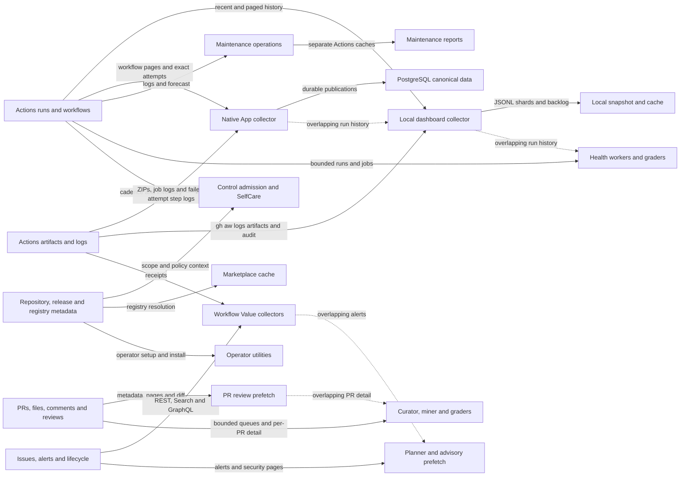

# Central Agentic Ops Data Acquisition Audit

**Version:** 1.0.0  
**Status:** Working Draft  
**Audit date:** 2026-11-14

## 1. Scope and method

This source-based inventory covers production GitHub REST, Search and GraphQL reads, `gh aw logs`, artifact downloads, prefetches, indexes and caches in the catalog and its Go runtime. Editable workflow Markdown, conventional Actions workflows, JavaScript, shell, Go, graders and setup utilities were inspected; generated locks are manifestations, not independent collectors. Tool availability is not proof of a call, and configured bounds are not measured traffic. Actual request totals depend on scope, events, access and returned pages.

The legacy Activity publisher, dashboard-artifact workflows and their shared cache are retired; historic entries in the [refresh ledger](./data-acquisition-audit-history.md) are not current architecture. Hosted dashboards use Go and PostgreSQL; Pages is a synthetic-only demo, not an operational source. Explicit operational JSONL artifacts remain supported. See [architecture](../ARCHITECTURE.md) and [server ingestion](./server-ingestion.md).

## 2. Acquisition inventory

| Producer and trigger | Acquisition, bounds and output | Reuse and completeness |
| --- | --- | --- |
| Local `gh cao dashboard` / `dashboard collect` (`internal/cli/dashboard_collect.go`, `dashboard_backfill.go`, `dashboard_logs.go`, `dashboard_serve.go`) | One rotating repository per pass: exact repo lookup, workflow inventory (limit 1,000), recent `gh run list`, cursor-paged `actions/runs` history, then `gh aw logs --artifacts all --audit --format jsonl` for observed workflow paths. Defaults: 200 runs, seven-day window, five-minute refresh; the logs command has a two-minute timeout. | A 500-request pass budget and live core reserve of `max(1000, ceil(limit/5))` are rechecked before admitted commands. History uses closed windows and at most 100 results per page; windows over GitHub's 1,000-result cap split, and an unsplittable creation second fails incomplete. Checkpoints survive quota pauses. A newest-first, 5,000-run artifact backlog retries unfinished enrichment and skips current attempts; artifact ceilings are reported as partial. Managed JSONL cache is bounded to 256 MiB; open-ended listings refresh. While backfill is incomplete, passes can recur after two seconds; quota pauses wait toward reset (bounded by normal refresh), watching/failed states use normal cadence, and unreadable or failed ingestion state with no runs retries within 30 seconds. |
| Native App collector (`server/internal/collectnative/`, `server/internal/collect/run_enumeration.go`, `server/internal/collect/backfill.go`) | When explicitly configured, installation-scoped native Go collection replaces subprocess acquisition. Historical discovery pages workflow registry and then each `.lock.yml` workflow's runs within frozen UTC bounds; each admitted attempt is checked by exact run/attempt, then artifact pages and allowlisted ZIPs are fetched. Attempt job pages and completed, non-skipped job logs are also acquired for audit evidence (`jobs.go`); failed attempts additionally request exact-attempt step-log archives (`audit_validation.go`). Native inventory additionally reads repository metadata, default-branch commit, latest compiler release, workflow pages and lock contents (`inventory_github.go`). | Durable enrollment-epoch and receipt-fenced tasks, publication intents and installation quota protect scope and progress. Native history rejects a filtered workflow result above 1,000 or incomplete pagination rather than pretending completion. Defaults include 100 pages, 100 artifacts and 32 MiB per acquisition; archive entries and lines are bounded (`evidence.go`). Inventory stops at ten 100-item pages and records incomplete coverage. No blanket conditional-read cache is assumed. The legacy repository-wide `enqueueHistoricalRuns` branch in `backfill.go` is not the native discovery path. |
| App scope repair (`server/internal/collect/discovery.go`) | Scheduled installation enumeration and per-installation repository pages, hourly by default, independently of webhook delivery and cold-start scope discovery. | Shared quota applies; repeated full enumeration can scale with installations and repositories. Durable scope is authority, not a discovery cache. |
| Workflow Value (`server/internal/collect/projector_remote_value_*.go`, `.github/value-collectors/`, `.github/skills/add-operational-value/`) | Explicitly registered File Diet evidence uses bounded Search, issue/PR lifecycle REST and GraphQL, source commits and Actions artifact receipts; Dependabot evidence uses cursor-paged alerts and bounded PR Search under a 111-request grant. | File Diet's incremental proof reuses retained immutable evidence but refreshes mutable relationships. The native reader memoizes within an acquisition and enforces reviewed requirements and budgets; core, search and GraphQL are distinct quota pools. Missing, capped or inaccessible evidence must not become complete evidence. |
| Control admission and dispatch (`.github/workflows/shared/control.md`, `control.mjs`) | Each importing run checks out control `.github` at workflow SHA and resolves policy, quota, repository and workflow inventory through injected Octokit; `gh api --cache 60s` is a fallback. Workflow inventory pages 100 at a time and rejects more than 10,000. Manual debug actor permission is deliberately rechecked at admission and precompute. | Per-run work is isolated; workflow inventory can use a separate credential. Preserve exact-SHA policy and fresh authority checks, even where other reads can be reused. |
| PR review prefetch (`shared/pr-review-context.md`, `design-decision-gate.md`, `mattpocock-skills-reviewer.md`, `test-quality-sentinel.md`, `service-architecture-reviewer.md`) | Each invocation reads PR metadata twice, paginates changed files and review comments, and fetches the diff only for at most 300 files; the emitted general and test patches are each capped at 3,000 lines. The architecture reviewer adds bounded head/base architecture reads. | Prefetch code is shared, not results. File-count mismatch, API failure or changed head fails the prefetch; truncated or unavailable evidence must not be used as complete review evidence. |
| Repository queues and maintenance (`pr-sous-chef.md`, `repo-assist-*.md`, `dreaming-agents-md-curator.md`, `self-care.md`) | Sous Chef polls up to 50 non-draft labeled PRs every 30 minutes and shortlists up to four; repo-assist separately scans bounded issue/PR queues. Curator lists recent merged/open PRs and then per-PR comments/files. SelfCare checks recent worker runs for cadence. | Fixed-schedule scans and full-history checkouts are independent; per-PR detail is N+1. Some maintainers retain private cursors, but they do not share an evidence snapshot. Cadence checks fail closed on ambiguous history. |
| Incident and status prefetch (`cao-evolution-failures-investigator.md`, `cao-framework-health.md`, `daily-repo-status.md`) | Failure investigation pages up to five run-history pages and details at most five failures with bounded log tails. Framework health and daily status independently read bounded recent runs, jobs, issues and related metadata. | Overlapping Actions windows are re-read across runs and graders; limits constrain work but do not prove full history. |
| Security and dependency prefetch (`dependabot-update-planner.md`, `uk-ai-advisory-operational-resilience.md`) | The planner validates target and visibility, then follows alert `after` cursors at 100/page up to 100 pages, writing a run-local evidence file. The advisory worker reads bounded repository, recent commits, security issues and scanning/Dependabot alerts. | The planner marks rate limits, invalid cursors and exhausted pagination unavailable rather than complete. The advisory's independent bounded alert pages overlap the planner's evidence but may have different coverage and access. |
| Rule mining and graders (`eslint-rules-miner.md`, campaign `.github/graders/`) | Miner reads one bounded merged-PR search page, commits, then files/comments for up to ten PRs. Dependabot grader reads a parent, sub-issues and per-child comments/timelines; docs and failure graders read Actions history; EU CRA grader reads ledger commits, associated PRs and reviews. | Candidate detail is N+1 and evidence is not shared across evaluators. Some miner command failures yield empty outputs; absence must not be interpreted as verified absence. Graders are conditional evaluations, not a retired scheduled Activity publisher. |
| Maintenance and operator utilities (`agentics-maintenance.yml`, `install-gh-cao.sh`, `internal/cli/`) | Explicit maintenance operations run `gh aw logs` over one week/up to 500 runs or `gh aw forecast`, each with its own Actions cache. Setup, admission and installer operations independently inspect repository, workflow/variable or release metadata as needed. | These are separately triggered, not a common operational snapshot. Cache keys and restore prefixes do not make forecast, maintenance logs and dashboard evidence interchangeable. |
| Marketplace (`server/internal/marketplace/`) | Configured registries resolve repository/ref/tree/manifest and public popularity metadata through GitHub. | Registry ID plus dashboard generation keys the cache; default TTL is five minutes (`marketplace.go`). Misses and revision changes can repeat registry reads. |

## 3. Cache and index safety

Local dashboard shards, cursor and backlog are scoped per repository and are not control-plane policy. Native PostgreSQL acquisition state, queues and published canonical records have separate ownership and retention; replaying retained native publications need not call GitHub. Request-scoped Value memoization, Actions maintenance caches, PR prefetch files and marketplace cache have different keys, completeness and freshness guarantees. Browser IndexedDB and service-worker caches are disposable derived demo/static state, not worker authority or an operational collection service. Explicit snapshot acquisition requires an authenticated artifact or a trusted direct `payload-hashes.json` URL and hash verification; never substitute Pages.

Any proposed shared cache must bind repository identity, credential visibility, source, workflow SHA or exact run/attempt where applicable, acquisition window, schema, freshness, completeness and provenance. Do not share private evidence across authorization boundaries, infer missing data as empty, bypass quota/enrollment checks, reuse mutable PR state after its head changes, or mix synthetic and operational evidence. Partial, capped, expired and unavailable results must remain distinguishable from complete results. Conditional reads are useful only where validators and access semantics are preserved.

## 4. Duplicate work and prioritized bottlenecks

| Priority | Evidence and consequence |
| --- | --- |
| P1 | Local collection lists recent runs, pages history and asks `gh aw logs` to enumerate overlapping runs. Two-second backfill passes make quota governance important even though the backlog and checkpoints avoid losing progress. Native collection and separately triggered maintenance/graders can independently acquire the same Actions windows; no shared cross-process cache is established. |
| P1 | Native historical discovery scales with enrolled repositories, workflows and pages; each attempt can fan out to artifact pages/ZIPs and job pages/logs, failed attempts to step-log archives, while inventory separately reads lock sources. Hourly installation/repository repair adds another scan. Capped history fails rather than silently dropping data. |
| P1 | File Diet's lifecycle reads and Dependabot's alerts/Search compete with other core, search and GraphQL consumers. Per-invocation bounds do not establish fleet-wide volume or equal quota costs. |
| P2 | Shared PR-review implementation still refetches per invocation; curator, rule miner, maintainers and graders also fetch overlapping files, comments, reviews or timelines individually. Head and scope validation are essential counterweights to caching. |
| P2 | Fixed queue polling, cadence checks, separate workflow/credential inventories, and cold cache misses repeat bounded metadata reads. Permission rechecks are intentional security controls, not redundant reads to remove blindly. |
| P2 | Independent maintenance caches, local shards and run-local prefetch files cannot automatically satisfy other consumers: keys, windows, attempt identities, visibility and completeness differ. A single shared store without those distinctions would be unsafe. |

These are source-based priorities, not measured quotas or an assertion that all optional paths run together. Search and GraphQL pressure must be measured independently of core REST; quota checks, partial coverage and rate-limit failures are part of the observed contract.

## 5. Staged recommendations

1. **Measure first:** record per-operation pages, cache hits, quota pool, partial reason and elapsed time without sensitive payloads; compare cold and warm runs by repository and trigger. Verify real quota and completeness before ranking by volume.
2. **Reduce safe duplicate reads:** investigate reusing validated run/attempt metadata across local history and logs, and versioned head-bound PR prefetch within a single invocation. Preserve exact identity, head rechecks, cancellation and explicit incomplete states; do not remove authorization checks.
3. **Incremental discovery:** evaluate durable scoped cursors or conditional reads for queue and inventory scans, with overlap windows, tombstones, verification and reset behavior. Test GitHub pagination caps and concurrent updates; never replace the native frozen-window/receipt fencing with an unsafe watermark.
4. **Coordinate budgets:** assess core/Search/GraphQL demand across optional Value, native, maintenance and grader operations; schedule or defer fairly without extending credentials or policy. Retain per-operation ceilings, quota reserve and honest partial reporting.
5. **Share only contract-compatible evidence:** pilot cross-consumer reuse only after provenance, visibility, attempt, freshness and retention are explicit and independently tested. Do not resurrect retired publishers or use browser state as a fleet service.

## API Request Relationships

